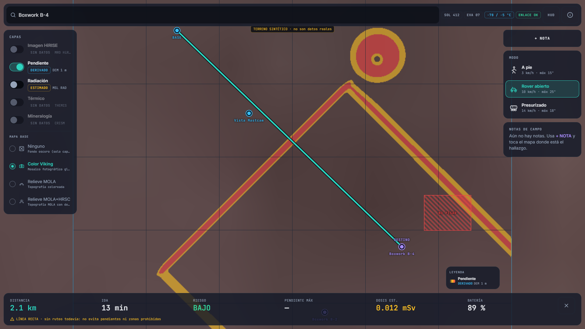
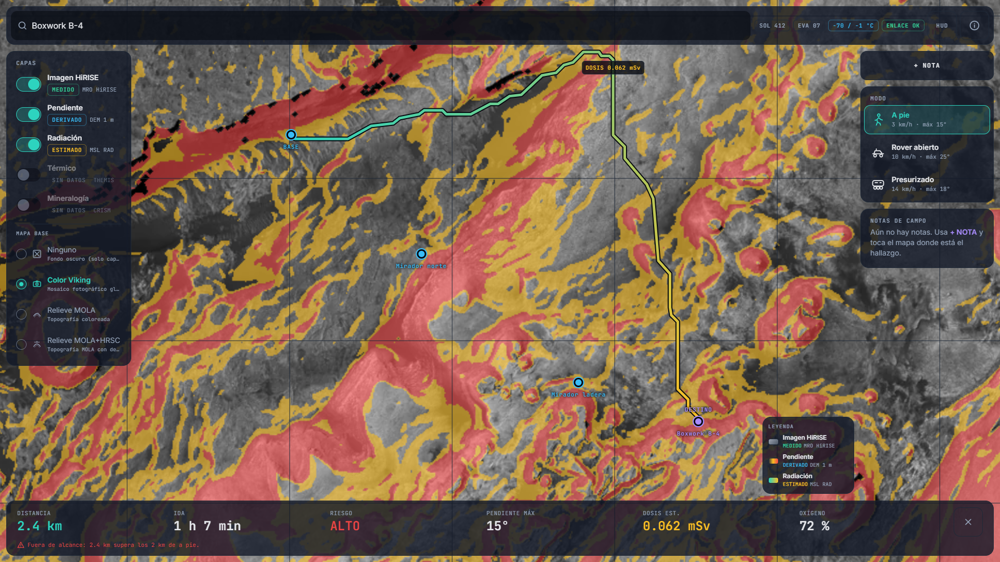
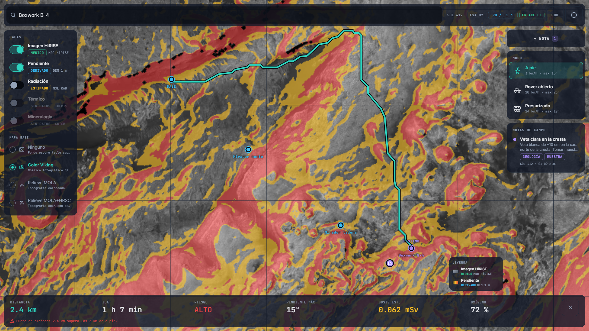
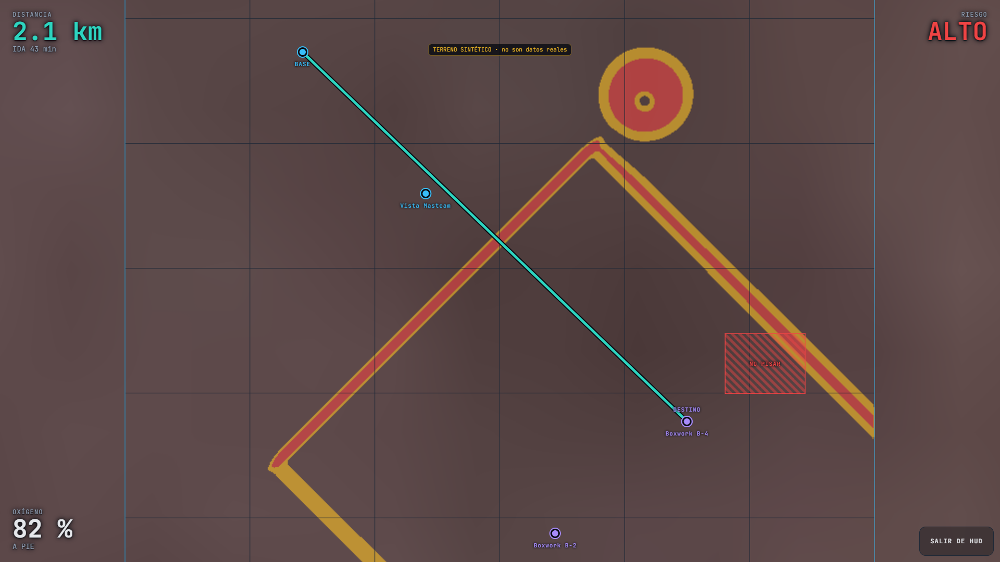

<p align="center">
  
  
  
  
  
  
</p>

# MARSWALK

> 🇬🇧 English version: [README.md](README.md)

**Un «Google Maps» para caminar en Marte.** El astronauta marca un destino, elige cómo se mueve (a pie, rover abierto o rover presurizado) y la app calcula la ruta más segura sobre datos reales de NASA. El peligro se ve en el mapa y se mide en lo que cuesta: tiempo, oxígeno y dosis de radiación.

> **Reto:** *Interplanetary Survival Guide: Martian Map*, NASA Space Apps Challenge 2026.

| | |
|---|---|
| **App en línea** | **https://martianmap-rosy.vercel.app** |
| **Video** | ⟨enlace al video⟩ |
| **Repositorio** | https://github.com/luablo/martianmap |
| **Fuentes, herramientas y cómo se hizo** | [RESOURCES.md](RESOURCES.md) (en inglés) |

---

## El problema

Los mapas de Marte se hicieron para mirar el planeta, no para caminarlo. Mars Trek y los mapas del USGS son vistas regionales o globales, y con ellos nadie puede planear una caminata concreta de 2 a 3 km. MARSWALK cubre ese hueco con una vista **hiperlocal, por capas, pensada para una EVA** (actividad extravehicular).

## La misión de la demo

> **Sol 412, EVA 07.** Dos astronautas salen de la base, en la falda de Mount Sharp, para muestrear una cresta de *boxwork* a unos 2.4 km. Abren MARSWALK y marcan «Boxwork B-4». La app traza la ruta a pie evitando las laderas demasiado empinadas para el traje. Cambian a rover abierto y la ruta cambia sola. Al llegar dejan una nota con foto, y la nota aparece en el mapa del compañero.

*Zona: un recorte limpio de un modelo de elevación HiRISE en el cráter Gale, donde trabaja Curiosity (137.26–137.33 °E, 4.73–4.94 °S, unos 3.9 × 12.2 km). Objetivo científico: las formaciones boxwork, evidencia de agua subterránea antigua. La base de la EVA es un punto supuesto dentro de la zona; Bradbury Landing queda fuera de este recorte.*

## Capturas

<p align="center">
  
  <br><em>Ruta calculada de la base al objetivo, evitando las zonas rojas, con sus métricas.</em>
</p>

<table>
  <tr>
    <td align="center"><br><em>El mismo destino en rover abierto: cambian la ruta y el riesgo</em></td>
    <td align="center"><br><em>Capas: imagen, pendiente y radiación</em></td>
  </tr>
  <tr>
    <td align="center"><br><em>Notas de campo con foto y coordenada</em></td>
    <td align="center"><br><em>Modo HUD para el visor del casco</em></td>
  </tr>
</table>

## Qué hace

- **Ruta segura:** A* de 8 vecinos sobre una malla de 4 m por celda, que minimiza el **tiempo** y nunca entra en terreno rojo.
- **Tres modos de transporte:** a pie, rover abierto y rover presurizado. Cambiar de modo recalcula la ruta.
- **Capas que se prenden y apagan:** imagen de órbita (HiRISE), pendiente y radiación, cada una con su etiqueta **MEDIDO / DERIVADO / ESTIMADO**, más mapas base (MRO CTX, Viking y MOLA) como contexto alrededor de la zona.
- **Métricas de la ruta:** distancia, tiempo, pendiente máxima, dosis de radiación (ida y vuelta), recurso restante (oxígeno o batería) y riesgo global.
- **Casos límite explicados:** destino inalcanzable, fuera de alcance del modo o recurso insuficiente muestran un aviso claro en lugar de una ruta falsa.
- **Pensada para guantes:** botones de 56 px o más, sin gestos finos ni *hover*, y el color nunca es la única señal (la zona prohibida lleva rayado y texto).
- **Notas de campo:** el astronauta escribe el mapa, con foto, etiquetas y coordenada, y el compañero lo ve en tiempo real.
- **Responsiva:** teléfono, tablet (objetivo principal) y pantalla del hábitat con el mismo código.

## Cómo responde al reto

| Lo que pide el reto | Cómo lo cumplimos |
|---|---|
| Al menos 3 tipos de datos | Óptico (HiRISE), topográfico (DTM HiRISE), radiación (MSL RAD) y clima (MSL REMS) |
| Ruta que evite obstáculos | A* con pendiente máxima por modo y polígonos «NO PISAR» |
| Seguridad y radiación | Dosis por ruta y blindaje distinto por modo |
| Movilidad con traje | Modos de transporte y recurso límite (oxígeno, batería) |
| Vista por capas | Capas con interruptores y leyenda |
| Observaciones de campo | Notas geolocalizadas con foto, compartidas en tiempo real |

## Datos de NASA usados

Cada capa dice en pantalla si es medida, derivada o estimada.

| Capa | Fuente | Etiqueta |
|---|---|---|
| Imagen de órbita | MRO **HiRISE**, ortofoto PSP_001488_1750 (RED) | MEDIDO |
| Pendiente | **DTM HiRISE** DTEEC_001488_1750 a 1 m/px, con la pendiente calculada por nosotros a 4 m por celda | DERIVADO |
| Radiación | **MSL RAD**: unos 0.67 mSv/día en superficie (Hassler et al., 2014) | MEDIDO (tasa) · ESTIMADO (dosis por ruta) |
| Clima del sol | **MSL REMS**, sol 412: −70 / 0 °C, 875 Pa, UV | MEDIDO |
| Mapas base | **MRO CTX** (Esri OnMars), **Viking** MDIM 2.1 y **MGS MOLA** (USGS Astrogeology) | contexto |

Las URLs exactas, fechas y créditos están en [`RESOURCES.md`](RESOURCES.md).

## Supuestos y limitaciones

Estos números **son supuestos del equipo, no datos de NASA**. Viven en un solo archivo, [`lib/modes.ts`](Frontend/martianmap/lib/modes.ts).

| | A pie | Rover abierto | Rover presurizado |
|---|---|---|---|
| Pendiente máxima | 15° | 25° | 18° |
| Velocidad en plano | 3 km/h | 10 km/h | 14 km/h |
| Alcance | 2 km | 20 km | 100 km |
| Recurso límite | Oxígeno del traje (8 h) | Batería (4 h) | Autonomía (72 h) |
| Factor de blindaje | 1.0 | 1.0 | 0.5 |

- **Velocidad real** = velocidad en plano × (1 − 0.6 × pendiente / pendiente máxima).
- **Dosis** = 0.67 mSv/día × tiempo de ruta (ida y vuelta) × factor de blindaje. Una EVA de unos 100 min da alrededor de 0.05 mSv.
- **Recurso** = 100 % − (tiempo de ida y vuelta / autonomía), con una reserva mínima del 20 % al volver.
- **Riesgo global (BAJO / MEDIO / ALTO):** sube si la ruta sale del alcance del modo, deja menos de 20 % de reserva o supera la pendiente máxima.
- **Limitaciones conocidas:** la dosis por ruta es una estimación a partir de una tasa promedio, no una medición en cada punto; las zonas «NO PISAR» se marcaron a mano; el modelo de velocidad es una simplificación; la base de datos de notas tiene políticas abiertas (solo para el hackathon, sin inicio de sesión).
- Si `public/data/gale/meta.json` dice `"fake": true`, esa zona usa **terreno sintético** de `scripts/fake-terrain.mjs` y no datos reales.

## Cómo funciona la ruta

```
costo(celda) = distancia / velocidad_real(pendiente, modo)
```

El A* corre en un **Web Worker**, así que la interfaz no se congela. Las celdas con pendiente mayor a la máxima del modo, o dentro de un polígono «NO PISAR», son infranqueables. Las distancias se calculan con el **radio de Marte (3 389.5 km)**, nunca con funciones de la librería de mapas, que asumen la Tierra.

## Arquitectura

```
DTM y ortofoto HiRISE de NASA
        │  data-pipeline/ (Python: recorte, pendiente, exportación)
        ▼
public/data/gale/  (archivos estáticos: malla de pendiente, imagen, puntos, zonas NO PISAR, clima)
        │
        ▼
App Next.js en el navegador ── mapa y capas con MapLibre
        │                     └─ A* en un Web Worker → métricas
        ▼
Supabase (notas, tiempo real, fotos)        Vercel (publica main)
```

```
.
├─ data-pipeline/            # Python: recorta, calcula pendiente y exporta
├─ Frontend/martianmap/      # App Next.js 16 + Tailwind 4
│  ├─ app/                   # Página y estilos globales
│  ├─ components/            # Mapa, paneles y componentes de interfaz
│  ├─ lib/                   # types, geo, modes, metrics, routing, notes
│  ├─ scripts/               # revisión de datos, terreno sintético y pruebas de ruta
│  └─ public/data/gale/      # Capas y datos de la zona
├─ supabase/schema.sql       # Base de datos de notas (tablas, tiempo real, bucket de fotos)
└─ presentacion/             # Guion del video, subtítulos y capturas
```

## Cómo correrlo

Necesitas **Node.js 20.9 o superior**.

```bash
git clone https://github.com/luablo/martianmap.git
cd martianmap/Frontend/martianmap
npm install
npm run dev
```

Abre <http://localhost:3000>.

**Notas de campo (opcional).** Crea un archivo `.env.local` con las llaves de tu proyecto de Supabase y corre [`supabase/schema.sql`](supabase/schema.sql) en su SQL Editor. Sin ellas, la app sigue funcionando y las notas se guardan en el navegador (`localStorage`).

```bash
NEXT_PUBLIC_SUPABASE_URL=tu-url
NEXT_PUBLIC_SUPABASE_ANON_KEY=tu-llave-anon
```

**Producción.** `npm run build` revisa primero los datos contra el contrato de `lib/types.ts` (`npm run check-data`) y se detiene si están rotos. Cada merge a `main` se publica solo en Vercel.

```bash
npm run build
npm start
```

**Si en Windows aparece «no es una aplicación Win32 válida»** (el binario de SWC quedó dañado), reinstálalo o arranca con Webpack: `npm run dev -- --webpack`.

## Pruebas

```bash
npx tsc --noEmit                      # tipos
npm run check-data                    # los datos cumplen el contrato
npx tsx scripts/test-astar.ts         # el A* rodea un muro con un hueco
npx tsx scripts/test-route.ts         # ruta completa en los tres modos
```

`test-route.ts` imprime PASS o FAIL por modo, junto con distancia, tiempo, pendiente máxima, dosis, recurso y riesgo.

## Uso de inteligencia artificial

Este proyecto se desarrolló con apoyo de **Claude** (Anthropic), un asistente de inteligencia artificial. Lo usamos para:

- escribir y revisar código (por ejemplo, el motor de rutas A*, el Web Worker y el cálculo de métricas);
- redactar documentación, como este README;
- planear el trabajo, desplegar la app y resolver errores durante el hackathon.

Las decisiones de diseño, la elección de datos y las pruebas fueron del equipo, que es responsable del resultado final. Las capturas salen de la app real; no se generaron imágenes con IA.

## Equipo

| Rol | Persona |
|---|---|
| Datos | Julieta Rodriguez Cid |
| Ruta | Fernanda De Jesus Gonzalez |
| Mapa | Julio Cesar Trinidad Garcia |
| Interfaz e historia | Luis Angel Carcamo Huerta |

## Créditos

Datos de NASA/JPL-Caltech, NASA/Univ. of Arizona (HiRISE), NASA/JPL/MSSS (CTX) y USGS Astrogeology Science Center. MSL RAD y MSL REMS vía el Planetary Data System de NASA. Los mosaicos CTX los sirve Esri Living Atlas (OnMars). Este proyecto no está afiliado ni respaldado por NASA.
