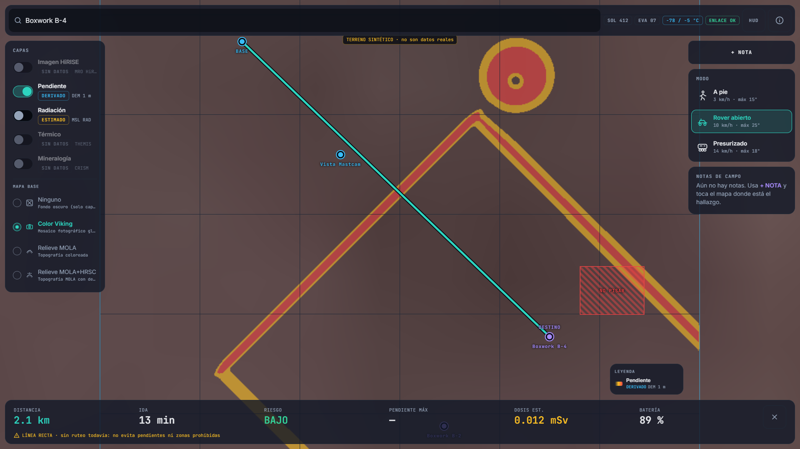
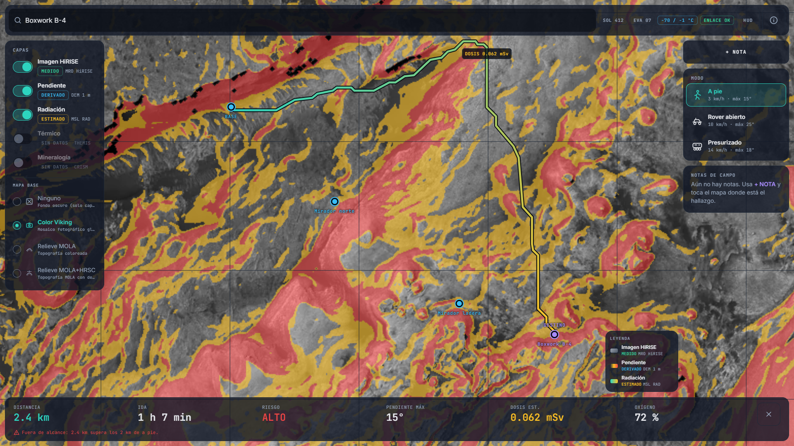
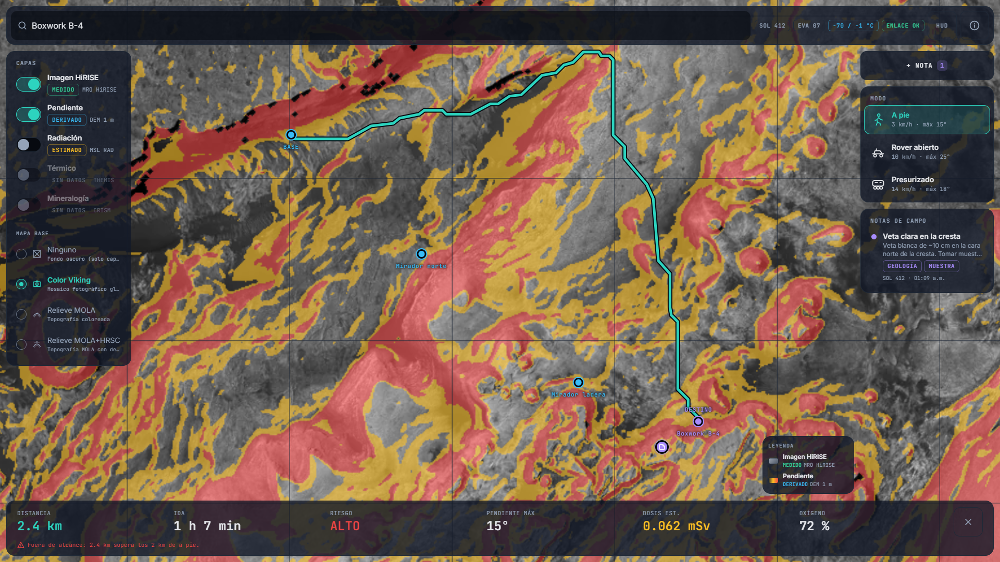
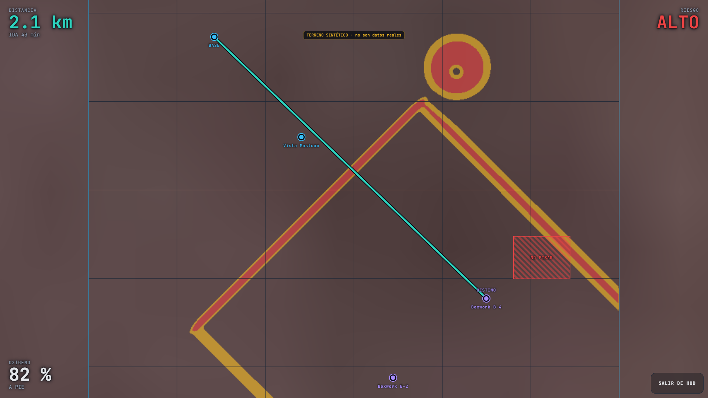

<p align="center">
  
  
  
  
  
  
</p>

# MARSWALK

> 🇪🇸 Versión en español: [README.es.md](README.es.md)

**The safe path across Mars, one tap away — even with gloves on.** A "Google Maps" for walking on Mars: the astronaut marks a destination, picks how to travel (on foot, open rover or pressurized rover) and the app computes the safest route over real NASA data. Danger is visible on the map and measured in what it costs: time, oxygen and radiation dose.

> **Challenge:** *Interplanetary Survival Guide: Martian Map*, NASA Space Apps Challenge 2026.

| | |
|---|---|
| **Live app** | **https://martianmap-rosy.vercel.app** |
| **Video (30 s)** | **[Watch on Google Drive](https://drive.google.com/file/d/1jNl4tkWjWRfV7VHoph0uLnI0YVjWQJjU/view?usp=sharing)** |
| **Repository** | https://github.com/luablo/martianmap |
| **Sources, tools and how it was built** | [RESOURCES.md](RESOURCES.md) |

---

## The problem

Existing Mars maps were made to look at the planet from orbit, not to walk it. Mars Trek and the USGS maps are regional or global views, and nobody can plan a concrete 2–3 km walk with them. MARSWALK fills that gap with a **hyperlocal, layered view designed for an EVA** (extravehicular activity).

## The demo mission

> **Sol 412, EVA 07.** Two astronauts leave the base on the lower slopes of Mount Sharp to sample a *boxwork* ridge about 2.4 km away. They open MARSWALK and pick "Boxwork B-4". The app draws the walking route around slopes that are too steep for a suit. They switch to the open rover and the route changes on its own. When they arrive, they leave a note with a photo, and the note appears on their partner's map.

*Area: a clean crop of one HiRISE elevation model in Gale crater, where Curiosity works (137.26–137.33 °E, 4.73–4.94 °S, about 3.9 × 12.2 km). Science goal: the boxwork formations, evidence of ancient groundwater. The EVA base is an assumed point inside the area; Bradbury Landing is outside this crop.*

## Screenshots

<p align="center">
  
  <br><em>Walking route from the base to Boxwork B-4, around the steep (red) terrain, with its metrics.</em>
</p>

<table>
  <tr>
    <td align="center"><br><em>Same target by open rover: the route and the risk change</em></td>
    <td align="center"><br><em>Layers: image, slope and radiation</em></td>
  </tr>
  <tr>
    <td align="center"><br><em>Field notes with photo and coordinates</em></td>
    <td align="center"><br><em>HUD mode for the helmet visor</em></td>
  </tr>
</table>

## What it does

- **Safe route:** 8-neighbor A* on a 4 m-per-cell grid that minimizes **time** and never enters terrain too steep for the mode or a NO-GO zone.
- **Three travel modes:** on foot, open rover and pressurized rover. Changing the mode recomputes the route.
- **Layers you can toggle:** orbital image (HiRISE), slope and radiation, each labeled **MEASURED / DERIVED / ESTIMATED**, plus base maps (MRO CTX, THEMIS relief, Viking color) for context around the area.
- **Route metrics:** distance, time, maximum slope, radiation dose (round trip), remaining resource (oxygen or battery) and overall risk.
- **Edge cases explained:** an unreachable destination, one out of range for the mode or not enough resource shows a clear warning instead of a fake route.
- **Built for gloves:** buttons of 56 px or more, no fine gestures or hover, and color is never the only signal (NO-GO zones have hatching and text).
- **Field notes:** the astronaut writes on the map, with a photo, tags and coordinates, and the partner sees it in real time (Supabase). Without network, notes are kept on the device.
- **EVA simulation:** "Start EVA" plays the trip: a dot leaves the base, follows the route, stops to sample and comes back, while mission time, dose and the remaining resource fill in live (accelerated).
- **Spanish / English:** the ES/EN button switches the whole interface; the choice is remembered on the device.
- **Responsive:** phone, tablet (main target) and habitat screen with the same code, plus a HUD mode.

## How it answers the challenge

| What the challenge asks | How we do it |
|---|---|
| At least 3 data types | Optical (HiRISE), topographic (HiRISE DTM), radiation (MSL RAD) and weather (MSL REMS) |
| A route that avoids obstacles | A* with a maximum slope per mode and NO-GO polygons |
| Safety and radiation | Dose per route and different shielding per mode |
| Mobility in a suit | Travel modes and a limiting resource (oxygen, battery) |
| Layered view | Layers with switches and a legend |
| Field observations | Geolocated notes with photo, shared in real time |

## NASA data used

Each layer says on screen whether it is measured, derived or estimated. Exact URLs, dates and credits are in [RESOURCES.md](RESOURCES.md).

| Layer | Source | Label |
|---|---|---|
| Orbital image | MRO **HiRISE** orthoimage PSP_001488_1750 (RED) | MEASURED |
| Slope | **HiRISE DTM** DTEEC_001488_1750, 1 m/px, slope computed by us at 4 m per cell | DERIVED |
| Radiation | **MSL RAD**: about 0.67 mSv/day at the surface (Hassler et al., 2014) | MEASURED (rate) · ESTIMATED (dose per route) |
| Weather of the sol | **MSL REMS**, sol 412: −70 / 0 °C, 875 Pa, UV | MEASURED |
| Base maps | **MRO CTX** (Esri OnMars), **Mars Odyssey THEMIS** IR Day and **Viking** MDIM 2.1 colorized (USGS Astrogeology) | context |

## Assumptions and limitations

These numbers **are team assumptions, not NASA data**. They live in one file, [`lib/modes.ts`](Frontend/martianmap/lib/modes.ts).

| | On foot | Open rover | Pressurized rover |
|---|---|---|---|
| Maximum slope | 15° | 25° | 18° |
| Speed on flat ground | 3 km/h | 10 km/h | 14 km/h |
| Range | 2 km | 20 km | 100 km |
| Limiting resource | Suit oxygen (8 h) | Battery (4 h) | Autonomy (72 h) |
| Shielding factor | 1.0 | 1.0 | 0.5 |

- **Real speed** = flat speed × (1 − 0.6 × slope / maximum slope).
- **Dose** = 0.67 mSv/day × route time (round trip) × shielding factor. An EVA of about 100 min gives around 0.05 mSv.
- **Resource** = 100 % − (round-trip time / autonomy), with a minimum reserve of 20 % on return.
- **Overall risk (LOW / MEDIUM / HIGH):** goes up if the route is out of the mode's range, leaves less than 20 % reserve or exceeds the maximum slope.
- **Known limitations:** the dose per route is an estimate from an average rate, not a measurement at each point; NO-GO zones were drawn by hand; the speed model is a simplification; the notes database has open policies (hackathon only, no login).
- If `public/data/gale/meta.json` says `"fake": true`, that area uses **synthetic terrain** from `scripts/fake-terrain.mjs` instead of real data.

## How the route works

```
cost(cell) = distance / real_speed(slope, mode)
```

The A* runs in a **Web Worker**, so the interface never freezes. Cells steeper than the mode's maximum, or inside a NO-GO polygon, are impassable. Distances use the **radius of Mars (3,389.5 km)**, never the map library's functions, which assume Earth.

## Architecture

```
NASA HiRISE DTM + orthoimage
        │  data-pipeline/ (Python: crop, slope, export)
        ▼
public/data/gale/  (static files: slope grid, image, points, NO-GO zones, weather)
        │
        ▼
Next.js app in the browser ── MapLibre map and layers
        │                    └─ A* in a Web Worker → metrics
        ▼
Supabase (notes, realtime, photos)        Vercel (hosting, publishes main)
```

```
.
├─ data-pipeline/            # Python: crop, compute slope and export
├─ Frontend/martianmap/      # Next.js 16 + Tailwind 4 app
│  ├─ app/                   # Page and global styles
│  ├─ components/            # Map, panels and UI components
│  ├─ lib/                   # types, geo, modes, metrics, routing, notes
│  ├─ scripts/               # data check, synthetic terrain and route tests
│  └─ public/data/gale/      # Layers and data for the area
├─ supabase/schema.sql       # Notes database (tables, realtime, photo bucket)
└─ presentacion/             # Video script, subtitles and screenshots
```

## Run it

You need **Node.js 20.9 or newer**.

```bash
git clone https://github.com/luablo/martianmap.git
cd martianmap/Frontend/martianmap
npm install
npm run dev
```

Open <http://localhost:3000>.

**Field notes (optional).** Create a `.env.local` file with your Supabase project keys and run [`supabase/schema.sql`](supabase/schema.sql) in its SQL Editor. Without keys the app still works and notes are saved in the browser (`localStorage`).

```bash
NEXT_PUBLIC_SUPABASE_URL=your-url
NEXT_PUBLIC_SUPABASE_ANON_KEY=your-anon-key
```

**Production.** `npm run build` first checks the data files against the contract in `lib/types.ts` (`npm run check-data`) and stops if they are broken. Every merge to `main` is published automatically on Vercel.

```bash
npm run build
npm start
```

**If Windows says "is not a valid Win32 application"** (the SWC binary is damaged), reinstall it or start with Webpack: `npm run dev -- --webpack`.

## Tests

```bash
npx tsc --noEmit                      # types
npm run check-data                    # data files match the contract
npx tsx scripts/test-astar.ts         # A* goes around a wall through a gap
npx tsx scripts/test-route.ts         # full route in the three modes
```

`test-route.ts` prints PASS or FAIL per mode, with distance, time, maximum slope, dose, resource and risk.

## Use of artificial intelligence

This project was developed with the help of **Claude** (Anthropic), an AI assistant. We used it to:

- write and review code (for example, the A* route engine, the Web Worker and the metrics);
- write documentation, such as this README;
- plan the work, deploy the app and fix errors during the hackathon.

Design decisions, data choices and testing were the team's, and the team is responsible for the final result. Screenshots come from the real app; no images were generated with AI.

## Team

| Role | Person |
|---|---|
| Data | Julieta Rodriguez Cid |
| Route | Fernanda De Jesus Gonzalez |
| Map | Julio Cesar Trinidad Garcia |
| Interface and story | Luis Angel Carcamo Huerta |

## Credits

Data from NASA/JPL-Caltech, NASA/University of Arizona (HiRISE), NASA/JPL/MSSS (CTX) and the USGS Astrogeology Science Center. MSL RAD and MSL REMS via NASA's Planetary Data System. CTX base map tiles served by Esri Living Atlas (OnMars). This project is not affiliated with or endorsed by NASA.
